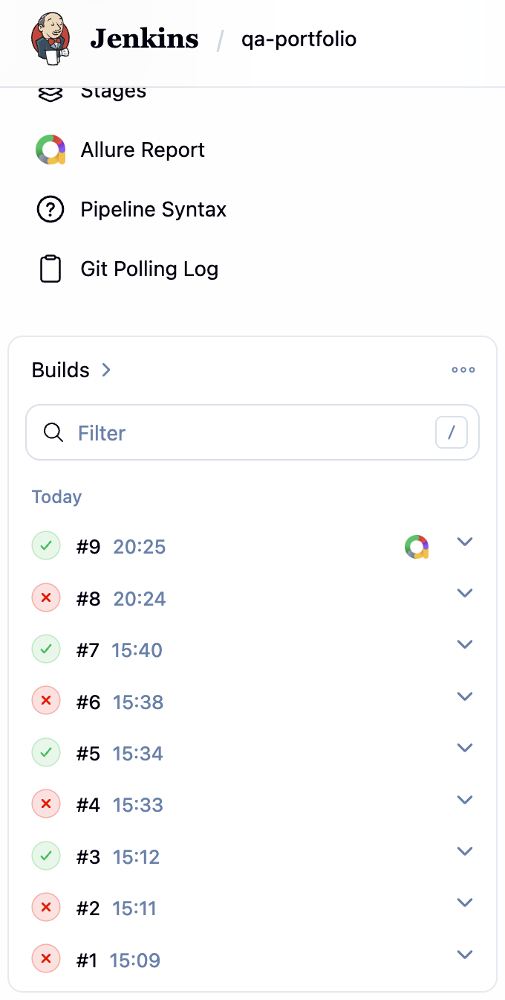
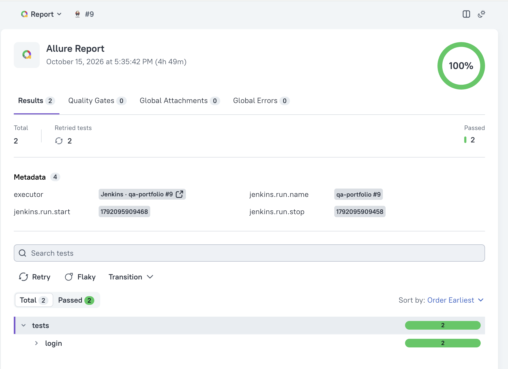
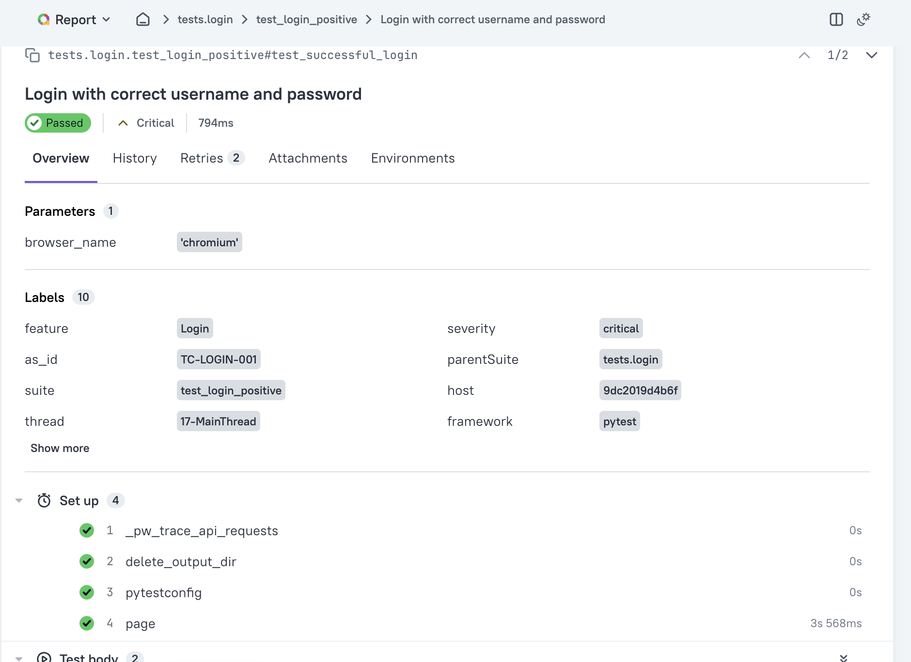
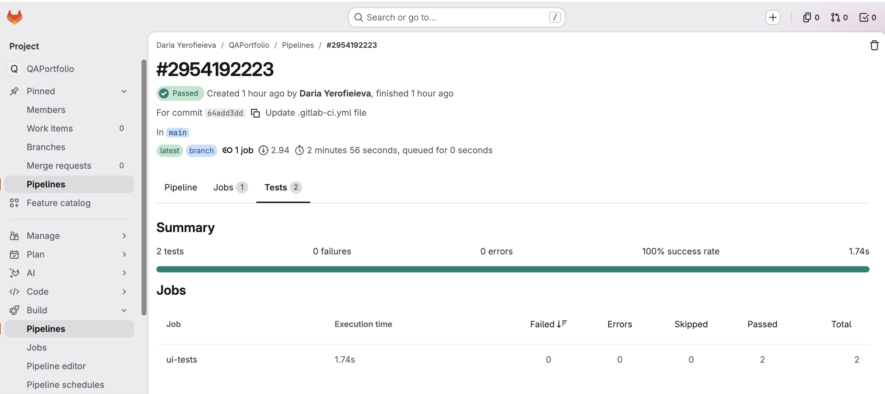

# py-plw-pet: UI test automation (Python + Playwright)

UI tests for the [Sauce Demo](https://www.saucedemo.com) login page, written with
Python, Playwright and pytest. Page Object pattern, test data kept separate from tests,
Allure reports with a screenshot attached to every failed test.


## Stack

- Python 3.12, pytest
- Playwright (Chromium)
- Allure Report
- Docker
- Jenkins, GitLab CI and GitHub Actions

## Project structure

```
pages/        Page Objects (LoginPage)
tests/        Test files, grouped by feature
test_data/    Test data (users, expected error messages)
test-cases/   Manual test cases (login.md)
conftest.py   Browser fixture, screenshot on failure
Dockerfile    Test environment
```

## Run locally

```bash
python -m venv .venv
source .venv/bin/activate
pip install -r requirements.txt
playwright install chromium
pytest --alluredir=allure-results
allure serve allure-results
```

## CI

Tests run automatically in three CI systems from the same repository.

### Jenkins

The [`Jenkinsfile`](../../Jenkinsfile) in the repository root describes the pipeline
(pipeline as code):

```
Git push → Jenkins polls the repo → builds the Docker image → runs pytest in the container → publishes the Allure report
```

- **Docker agent.** Jenkins builds the [`Dockerfile`](Dockerfile) (based on the official
  Playwright Python image) and runs every step inside it. The environment is identical
  on my machine, in CI and on a server, and nothing has to be installed on the Jenkins host.
- **Trigger.** `pollSCM` checks the repository every 5 minutes and starts a build on a new commit.
- **Quality gate.** If any test fails, the build turns red.
- **Report.** The `post { always { allure ... } }` block publishes the Allure report
  even when tests fail, so a failure can be investigated straight away.

| Build history | Allure report in Jenkins |
|---|---|
|  |  |

A passed test shows its steps, severity and ID:


I ran Jenkins locally in Docker (with access to the Docker socket for the Docker agent).
On a server the setup would be the same: Docker, a container with auto-restart, HTTPS and
a GitHub webhook instead of polling.

### GitLab CI

The repository is mirrored to GitLab: [gitlab.com/darya.erofeeva/qaportfolio](https://gitlab.com/darya.erofeeva/qaportfolio).
The pipeline is described in [`.gitlab-ci.yml`](../../.gitlab-ci.yml) and runs on every push:


- **Image.** The job runs in the official Playwright Python image, so no browsers or system
  libraries need to be installed on the runner.
- **Job `ui-tests`.** Installs dependencies and runs pytest, producing Allure results and a JUnit report.
- **Artifacts.** `allure-results` is saved even when tests fail (`when: always`);
  the JUnit report is shown in the pipeline's **Tests** tab.



### GitHub Actions

[`.github/workflows/tests.yml`](../../.github/workflows/tests.yml) runs the tests on every
push to `main` and publishes the Allure report to GitHub Pages.
